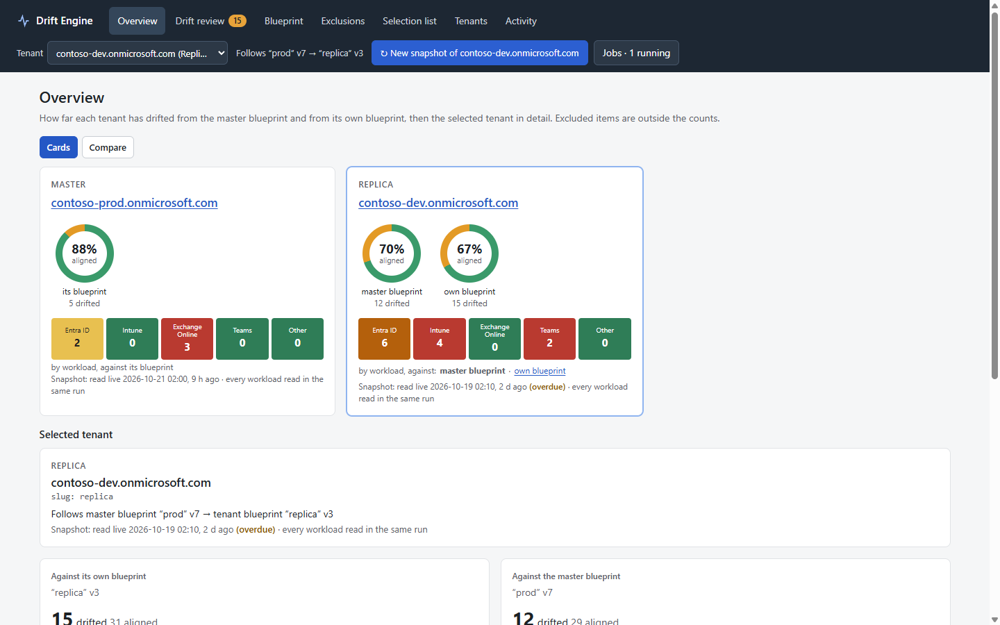
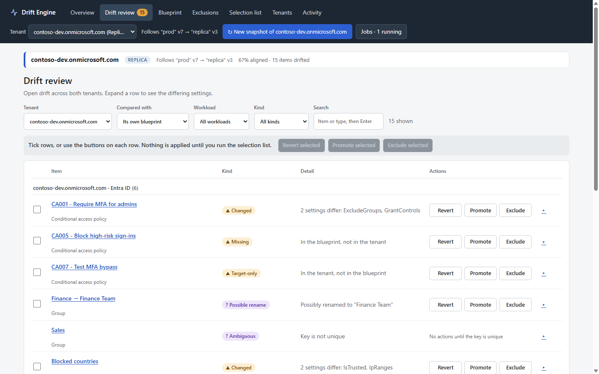
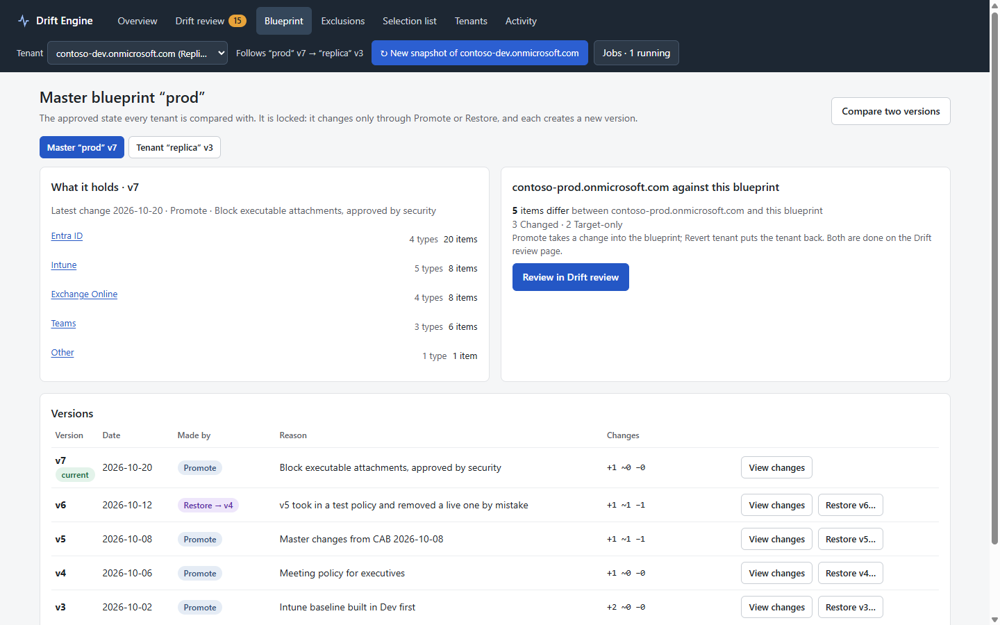

# M365dscGUI

A policy engine and local web GUI for Microsoft 365 tenants, built as a thin layer on top of [Microsoft365DSC](https://microsoft365dsc.com/) (DSC; [source on GitHub](https://github.com/Microsoft365DSC/Microsoft365DSC)). The GUI is served by [Pode](https://pode.readthedocs.io/), a PowerShell web framework (see [What is Pode?](#what-is-pode)).

> **Disclaimer.** This is an independent, community project. It is not affiliated with, endorsed by or supported by Microsoft or the Microsoft365DSC project. Microsoft 365 and related names are trademarks of Microsoft. The tool can **change settings in live tenants**. It is early-stage software provided "as is", without warranty (see `LICENSE`). Try it on a test tenant first, review every change before it is applied, and keep your own backups.

## What it is

Microsoft365DSC can export a tenant's configuration and apply a configuration back to it. M365dscGUI adds a policy layer around that:

- **Blueprints:** a tenant's approved configuration, stored as versions with history, review and restore.
- **Snapshots and drift:** a stored reading of a tenant, compared with a blueprint. Differences are shown as drift (Missing, Changed, Target-only, possible renames).
- **Multiple tenants:** one master blueprint compared against any number of replica tenants, each of which can also have its own blueprint.
- **Scopes and schedules:** check one resource type, or a slice of keys, quickly; run checks on a schedule.
- **Decisions:** for each drifted item, choose Revert (put the tenant back), Promote (take the drift into the blueprint) or Exclude (ignore it). Noise rules hide properties that always differ.
- **Offline tenants:** upload DSC export files of a tenant the tool cannot reach, compare them, and generate the configuration scripts for the tenant's pipeline owner to run.
- **A local web GUI** (Pode) to do all of the above, with safety rules around applying changes.

Export, comparison inputs, permissions and applying are done by Microsoft365DSC's own commands. This repo does not copy its resource lists or per-resource knowledge, so it keeps working when the module is updated. The pinned DSC version is in `src/PolicyEngine/Data/Versions.psd1`.

## Why it exists

The aim was to explore how far a small policy layer on top of Microsoft365DSC can go towards "configuration as policy" for M365 tenants: define what a tenant should look like once, see when a tenant drifts from it, and decide, item by item, whether to put the tenant back or accept the change, without writing a second implementation of DSC. The principles are in [`CLAUDE.md`](CLAUDE.md), the folder map in [`docs/overview.md`](docs/overview.md), and status, decisions and open items in [`docs/handover.md`](docs/handover.md).

## What it looks like

Screenshots of the GUI running on its built-in fake data set (`./gui/Start-PEGui.ps1 -Mock`).

**Overview:** how far each tenant has drifted from the master blueprint and from its own blueprint, by workload.



**Drift review:** every difference between a tenant and a blueprint, each with Revert, Promote and Exclude.



**Blueprint:** what the approved state holds and its version history, with view changes and restore.



## What is Pode?

[Pode](https://github.com/Badgerati/Pode) is an open-source, cross-platform web framework for PowerShell ([documentation](https://pode.readthedocs.io/), [module on the PowerShell Gallery](https://www.powershellgallery.com/packages/Pode)). It lets a PowerShell script act as a web server: routes, JSON APIs, static files, timers and background tasks, all written in PowerShell.

M365dscGUI uses it to serve the GUI. `gui/Start-PEGui.ps1` starts a small Pode server on `localhost` (port 8080 by default) that serves the static front end in `gui/public/` and a JSON API whose logic lives in `gui/PEGui.psm1`. The browser page is plain HTML, CSS and JavaScript with no build step and no third-party code. Because Pode runs on PowerShell, the GUI can call the same module and Microsoft365DSC commands as the command-line tools, and nothing else needs installing (no Node.js, IIS or database).

The server only answers localhost host names and needs a per-run token, which `Start-PEGui.ps1` prints in the address to open, so another web page or process on the machine cannot drive it. Actions you choose in the GUI are written as request files; a separate worker (`tools\Start-PEGuiWorker.ps1`) picks them up and runs the checks and applies the changes. Details are in [`gui/README.md`](gui/README.md).

## Requirements

- Windows with **[PowerShell](https://learn.microsoft.com/powershell/scripting/install/installing-powershell-on-windows) 7.6 or later** (`winget install Microsoft.PowerShell`)
- **[Microsoft365DSC](https://microsoft365dsc.com/)** at the pinned version (installed by the script below)
- **[Pode](https://github.com/Badgerati/Pode) 2.12 or later** for the GUI (see [What is Pode?](#what-is-pode))
- **[Pester](https://pester.dev/) 5.7.1** to run the tests
- A Microsoft 365 tenant, preferably a test tenant, and an administrator who can grant consent (Global Administrator, or Privileged Role Administrator plus Application Administrator) to create the app registrations

## Install

```powershell
git clone https://github.com/Tayhall/M365dscGUI.git
cd M365dscGUI

# Optional: a local clone of Microsoft365DSC for reference (git-ignored)
git clone https://github.com/Microsoft365DSC/Microsoft365DSC.git

# Install Microsoft365DSC (pinned version) and its dependencies for the current user
pwsh -NoProfile -File tools\Install-M365DscDependencies.ps1

# Install Pode for the GUI
Install-PSResource -Name Pode -Scope CurrentUser
```

## Try it without a tenant

The GUI runs on a fake data set (two tenants, every finding kind, a blueprint history):

```powershell
./gui/Start-PEGui.ps1 -Mock
```

Open the address it prints (it carries a per-run token). The server only answers on localhost.

## Configure a real tenant

Secrets and certificates are never stored in the repo. App files go to `~\.m365dsc-policy\` and certificates to the CurrentUser certificate store. Runtime state goes to `data/` (git-ignored).

1. **Create the app registrations.** This signs in with a device code (MFA works) and creates a Reader app and a Writer app, their certificates, consent and roles, then registers the tenant:
   ```powershell
   pwsh -NoProfile -File tools\New-PETenantApps.ps1 -Slug master -TenantId contoso.onmicrosoft.com
   ```
   If you prefer to create the apps yourself with DSC's own commands, `tools\Get-PETenantSetup.ps1` prints them and `tools\Connect-PETenant.ps1` registers the result.
2. **Export the tenant and make the first blueprint:**
   ```powershell
   pwsh -NoProfile -File tools\Export-M365DscTenant.ps1 -OutputPath data\exports\blueprint-1
   pwsh -NoProfile -File tools\New-PEBlueprint.ps1 -Name demo -ExportPath data\exports\blueprint-1
   ```
3. **Run a check** (a full export compared with the blueprint):
   ```powershell
   pwsh -NoProfile -File tools\Invoke-PEFullCheck.ps1 -BlueprintName demo
   ```
4. **Start the GUI and its worker** (two terminals). The worker runs the checks and applies the changes the GUI requests:
   ```powershell
   Import-Module ./src/PolicyEngine/PolicyEngine.psd1
   Export-PEGuiData -BlueprintName demo -TenantDisplayName <name>
   ./gui/Start-PEGui.ps1
   pwsh -NoProfile -File tools\Start-PEGuiWorker.ps1 -BlueprintName demo
   ```

More on scopes, schedules, offline tenants and a demo on a dummy tenant is in `gui/README.md`. Security and Compliance resource types are check-only, and writing to the master tenant needs an explicit confirmation.

## Tests

```powershell
pwsh -NoProfile -File tools\Invoke-PETests.ps1 -Fast
```

The Pester tests run offline on fake exports.

## Documentation

| Document | What it covers |
| --- | --- |
| [`docs/overview.md`](docs/overview.md) | Folder map, tools and the words used in the GUI |
| [`docs/handover.md`](docs/handover.md) | Main status file: decisions, open items, known gaps |
| [`docs/apply-mechanics.md`](docs/apply-mechanics.md) | How changes are compiled and applied |
| [`docs/key-coverage.md`](docs/key-coverage.md) | How resource keys are covered |
| [`gui/README.md`](gui/README.md) | Running and extending the GUI |

## Licence

MIT, see [`LICENSE`](LICENSE).
